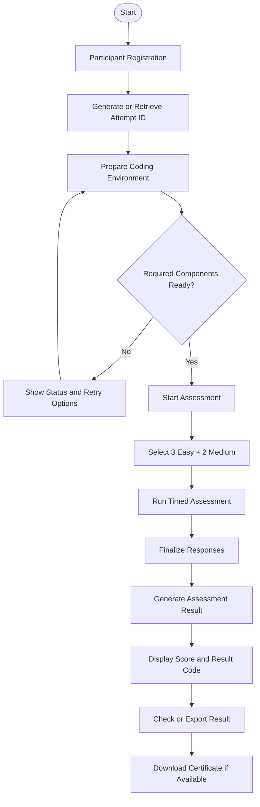
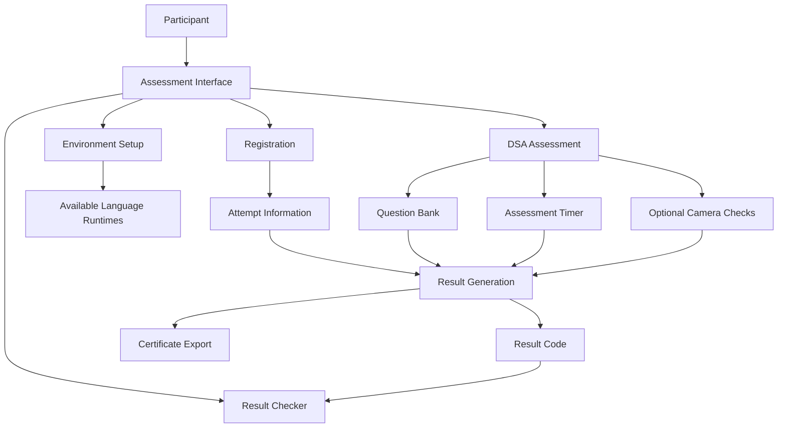
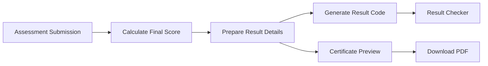

# DSA Assessment by Hack The Future

<p align="center">
  
</p>

<h3 align="center">A Structured Coding Assessment Experience for Aspiring Developers</h3>

<p align="center">
  Practice problem-solving, demonstrate programming skills, and evaluate your performance through a structured DSA assessment experience.
</p>

<p align="center">
  <strong>Developed by Vansh Raj Singh</strong><br/>
  Founder & Lead Developer, Hack The Future
</p>

<p align="center">
  <a href="https://hackthefuture.in">Website</a> •
  <a href="https://github.com/vanshrajputcodes">GitHub</a> •
  <a href="https://www.linkedin.com/in/linkvansh/">LinkedIn</a> •
  <a href="https://www.instagram.com/ig_vanshsingh/">Instagram</a> •
  <a href="https://www.youtube.com/@vanshrajputcodes">YouTube</a>
</p>

---

## Overview

**DSA Assessment by Hack The Future** is a browser-based coding assessment project designed to evaluate participants on Data Structures and Algorithms (DSA) through a structured, timed assessment workflow.

The project brings together participant registration, randomized question selection, a coding environment, assessment timing, result generation, and result verification in one assessment experience.

It is built around a simple objective: make coding assessments structured, accessible, and easier to navigate for students and aspiring developers.

## Key Features

| Feature | Description |
|---|---|
| Participant Registration | Collects participant details before starting an assessment. |
| Unique Attempt ID | Associates an assessment attempt with its generated identifier. |
| Randomized Question Selection | Selects 3 Easy and 2 Medium questions for an attempt. |
| Timed Assessment | Provides a 150-minute assessment duration. |
| Multi-language Coding | Designed for C, C++, Java, Python, and JavaScript, subject to the availability of a working execution engine for each language. |
| Coding Environment Setup | Displays environment preparation status and component readiness. |
| Assessment Monitoring | Includes optional camera-based checks and warning events where supported and permitted. |
| Result Generation | Presents the participant's assessment result and score. |
| Result Checker | Provides a separate interface for checking assessment results using a result code. |
| Result Export | Supports result-code handling and local export options where implemented. |
| Certificate Generation | Intended to provide a downloadable certificate containing assessment details and the participant's score. |
| Hindi & English Instructions | Intended language selection for assessment instructions and voice guidance. |

> **Implementation note:** Features marked as intended or dependent on language execution support should be considered complete only after they have been implemented and tested in the repository.

## Assessment Structure

| Parameter | Details |
|---|---|
| Assessment Name | DSA Assessment by Hack The Future |
| Total Questions | 5 |
| Easy Questions | 3 |
| Medium Questions | 2 |
| Maximum Score | 150 marks |
| Marks per Question | 30 |
| Time Limit | 150 minutes |
| Question Selection | Randomized per attempt |
| Result Identification | Unique attempt ID and result code |

### Question Categories

| Difficulty | Example Problems |
|---|---|
| Easy | Two Sum |
| Easy | Reverse an Array In-Place |
| Easy | Move All Zeroes to the End |
| Easy | Find Missing Number from 1 to N |
| Easy | Sort Array Using Bubble Sort |
| Medium | 3Sum |
| Medium | Maximum Subarray Sum |
| Medium | Best Time to Buy and Sell Stock |
| Medium | Longest Substring Without Repeating Characters |
| Medium | Search in Rotated Sorted Array |

The question bank contains problems at different difficulty levels. The intended selection rule is **exactly 3 Easy and 2 Medium questions per attempt**.

## Assessment Workflow



## System Architecture

The assessment is designed around a browser-based workflow. Actual execution, persistence, and verification capabilities depend on the code and services configured in the repository.



**Architecture principles**

- Keep the participant workflow straightforward and predictable.
- Separate assessment execution from result-checking interfaces.
- Preserve the attempt identifier throughout the assessment lifecycle.
- Display clear status messages when an environment component is unavailable.
- Avoid representing a code-execution engine or verification mechanism as functional unless it has been tested.

## Technology & Browser Capabilities

The exact framework and dependency versions should be confirmed from the project's package manifest.

| Component | Responsibility |
|---|---|
| Frontend Application | Registration, assessment screens, coding interface, and results |
| Question Bank | Stores and selects DSA problems |
| Browser Runtime | Supports browser-side functionality and supported language execution |
| Camera APIs | Enable optional camera access when permission is granted |
| Assessment State | Tracks the active attempt and assessment progress |
| Result Module | Produces the participant's result representation |
| Local Export | Enables supported client-side result or certificate downloads |

### Programming Language Support

| Language | Intended Support | Validation Requirement |
|---|---|---|
| C | Yes | Compile and execute actual C source code |
| C++ | Yes | Compile and execute actual C++ source code |
| Java | Yes | Compile and execute Java source code with a compatible runtime |
| Python | Yes | Execute Python source code in the configured runtime |
| JavaScript | Yes | Execute JavaScript source code in the configured runtime |

Language availability should be determined by actual runtime readiness, not by the presence of a language option in the user interface.

## Result & Certificate Workflow

The result workflow is intended to let participants review their assessment outcome after submission.



Potential certificate fields:

- Participant's full name
- Assessment title
- Final score out of 150
- Percentage
- Assessment completion date
- Attempt or certificate identifier
- Hack The Future branding

Certificate generation and downloads should be available only after the result has been finalized. A locally generated certificate is a record of the displayed assessment result; it is not, by itself, proof of independently verified identity or accreditation.

## Privacy & Security Considerations

| Area | Principle |
|---|---|
| Camera Permission | Camera access should require explicit browser permission. |
| Camera Processing | Any claim of local-only processing must be verified against the actual implementation. |
| Personal Information | Collect only the information required for the assessment workflow. |
| Result Codes | Client-generated codes should not be treated as tamper-proof proof of results. |
| Language Runtimes | Clearly communicate unavailable or failed execution components. |
| Downloads | Explain what is being exported and let the participant initiate the download. |
| Error Handling | Show actionable errors instead of false success states. |

**Important:** If result integrity, identity verification, or tamper-resistant certification is required, a client-only implementation has limitations. Those requirements need appropriate trusted verification mechanisms.

## Project Objectives

- Provide a structured environment for DSA assessment.
- Evaluate participants across multiple problem-solving difficulty levels.
- Maintain a consistent assessment flow with a defined time limit.
- Make environment readiness and failures visible.
- Provide a clear result-review experience.
- Create a foundation for future improvements to coding assessment and evaluation.

## Getting Started

### 1. Clone the Repository

Replace `YOUR-REPOSITORY-URL` with the actual GitHub repository URL.

```bash
git clone YOUR-REPOSITORY-URL
cd YOUR-REPOSITORY-FOLDER
```

### 2. Install Dependencies

Use the package manager corresponding to the lockfile in the repository.

```bash
npm install
```

### 3. Start the Development Server

For an npm project with a configured `dev` script:

```bash
npm run dev
```

Open the local URL printed in the terminal.

### 4. Production Build

If the project defines the standard build script:

```bash
npm run build
```

Run the project's configured checks and test the production build before deployment.

> These commands assume a compatible Node.js-based project with the corresponding scripts. Confirm the actual scripts in `package.json` before using them.

## Development Principles

- Preserve existing assessment behavior when introducing new features.
- Keep the assessment title consistent across relevant screens and result documents.
- Do not expose a language as ready until its execution engine has passed a real test.
- Keep result generation and certificate export aligned with finalized assessment data.
- Provide useful loading, error, retry, and unavailable states.
- Test both successful and unsuccessful assessment paths before release.

## Future Improvements

- Stronger server-side result validation, if a trusted backend is introduced.
- Automated tests for question selection, scoring, and timer behavior.
- More robust language execution and sandboxing.
- Accessible keyboard navigation and reduced-motion support.
- Improved certificate verification.
- Better reporting and assessment analytics.
- Expanded question banks and configurable assessment formats.

## Developed By

<p align="center">
  <strong>Vansh Raj Singh</strong><br/>
  Founder & Lead Developer — Hack The Future
</p>

I build web applications, AI-powered products, developer tools, and technology experiences focused on learning and skill development.

### Connect With Me

| Platform | Profile |
|---|---|
| Portfolio | [vanshrajput.in](https://vanshrajput.in) |
| GitHub | [@vanshrajputcodes](https://github.com/vanshrajputcodes) |
| LinkedIn | [Vansh Raj Singh](https://www.linkedin.com/in/linkvansh/) |
| Instagram | [@ig_vanshsingh](https://www.instagram.com/ig_vanshsingh/) |
| YouTube | [@vanshrajputcodes](https://www.youtube.com/@vanshrajputcodes) |
| Hack The Future | [hackthefuture.co.in](https://app.hackthefuture.co.in) |

## About Hack The Future

**Hack The Future** is a technology and skill-development initiative focused on helping learners explore programming, emerging technologies, and career-building opportunities.

Website: [https://hackthefuture.co.in](https://app.hackthefuture.co.in)

---

<p align="center">
  Built with a focus on learning, problem-solving, and practical development.
  <br/>
  <strong>Developed by Vansh Raj Singh | Hack The Future</strong>
</p>
